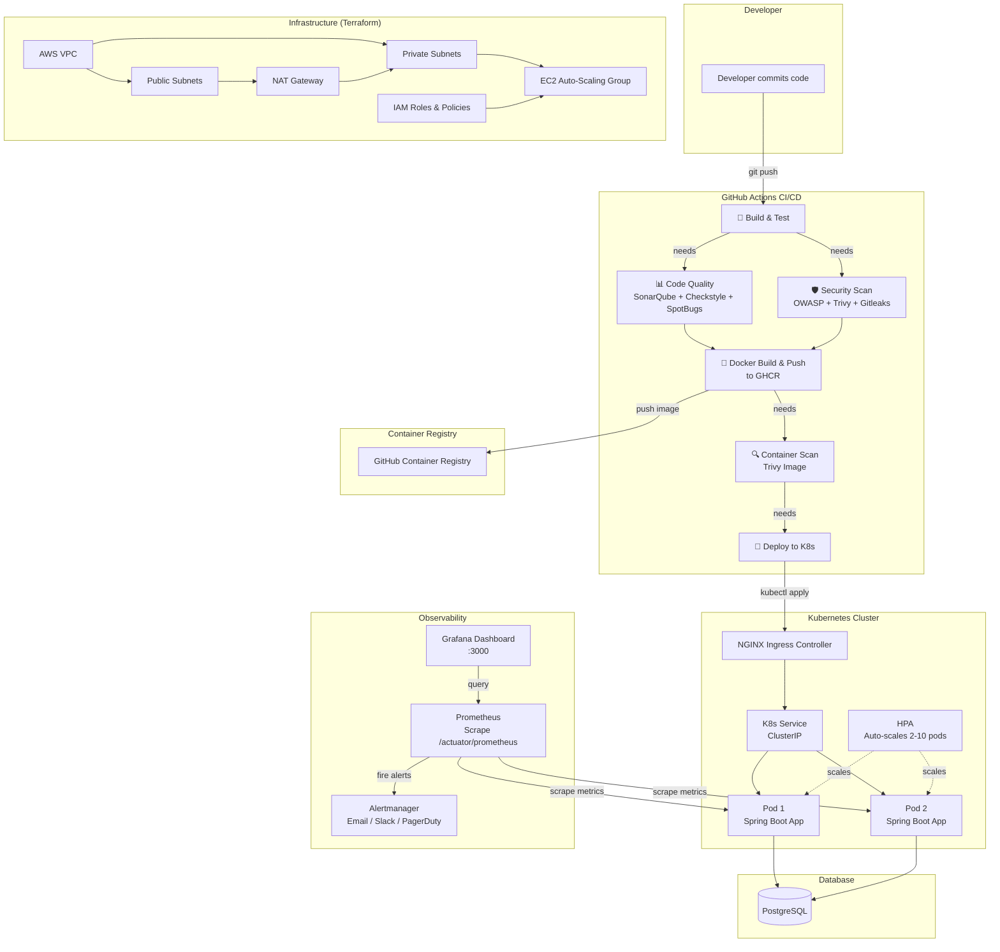
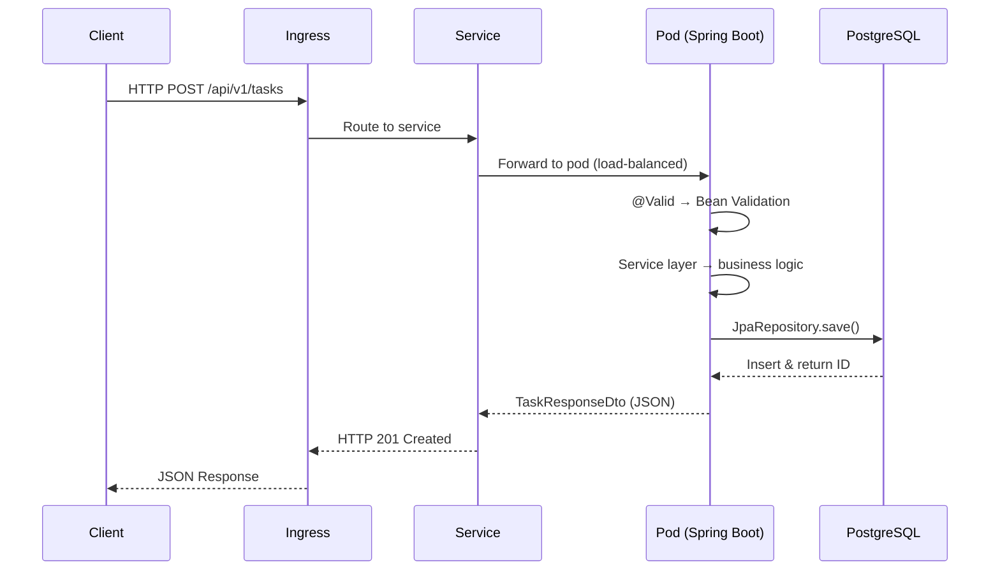

# 🔒 Secure Delivery Pipeline

> A production-grade **Java Spring Boot** application demonstrating modern **DevSecOps** practices: CI/CD, automated security scanning, Infrastructure as Code, containerization, Kubernetes deployment, and full-stack observability.

[](https://github.com/devsecops/secure-delivery-pipeline/actions/workflows/ci.yml)
[](https://github.com/devsecops/secure-delivery-pipeline/actions/workflows/security.yml)
[](https://github.com/devsecops/secure-delivery-pipeline/actions/workflows/terraform.yml)
[](https://github.com/devsecops/secure-delivery-pipeline/actions/workflows/codeql.yml)
[](https://opensource.org/licenses/MIT)

---

## 📑 Table of Contents

- [Project Overview](#-project-overview)
- [Architecture Diagram](#-architecture-diagram)
- [Technology Stack](#-technology-stack)
- [Directory Structure](#-directory-structure)
- [Local Development Guide](#-local-development-guide)
- [Docker Setup Guide](#-docker-setup-guide)
- [Kubernetes Deployment Guide](#-kubernetes-deployment-guide)
- [Terraform Deployment Guide](#-terraform-deployment-guide)
- [CI/CD Workflow Explanation](#-cicd-workflow-explanation)
- [Security Scanning Explanation](#-security-scanning-explanation)
- [Monitoring & Metrics Guide](#-monitoring--metrics-guide)
- [Troubleshooting](#-troubleshooting)
- [Future Improvements Roadmap](#-future-improvements-roadmap)
- [License](#-license)

---

### What This Project Demonstrates

| Area | What's Covered |
|---|---|
| **Application** | Java 21, Spring Boot 3, REST API, complete CRUD, JPA/Hibernate, global exception handling, validation |
| **Testing** | Unit tests (Mockito), integration tests (Testcontainers), JaCoCo coverage > 80% |
| **Containerization** | Multi-stage Dockerfile, non-root user, health checks, docker-compose with full stack |
| **CI/CD** | GitHub Actions: build → test → quality → security → publish → deploy (6-job pipeline) |
| **Code Quality** | SonarQube, Checkstyle, SpotBugs with FindSecBugs |
| **Security** | OWASP Dependency Check, Trivy, Gitleaks, CodeQL SAST, pipeline fails on critical CVEs |
| **IaC** | Terraform: modular architecture (VPC, SG, IAM, EC2) with AWS-ready infrastructure |
| **Kubernetes** | Deployment, Service, ConfigMap, Secret, Ingress, HPA, NetworkPolicy, PDB |
| **Observability** | Prometheus, Grafana, Spring Boot Actuator, custom application metrics |

---

## 🏗 Architecture Diagram



### Request Flow



---

## 🧰 Technology Stack

### Application

| Technology | Version | Purpose |
|---|---|---|
| Java | 21 (LTS) | Programming language |
| Spring Boot | 3.2.5 | Application framework |
| Spring Data JPA | 3.2.5 | ORM & data access |
| Hibernate | 6.x | JPA implementation |
| PostgreSQL | 15 | Relational database |
| Flyway | 9.x | Database migration |
| Lombok | 1.18.x | Boilerplate reduction |
| Micrometer | 1.12.x | Application metrics |

### Testing

| Technology | Version | Purpose |
|---|---|---|
| JUnit 5 | 5.10.x | Test framework |
| Mockito | 5.x | Mocking for unit tests |
| Testcontainers | 1.19.8 | Integration tests with real PostgreSQL |
| AssertJ | 3.25.x | Fluent assertions |
| JaCoCo | 0.8.12 | Code coverage (threshold: 80%) |

### DevOps & Infrastructure

| Technology | Version | Purpose |
|---|---|---|
| Docker | 25+ | Containerization |
| Docker Compose | 2.24+ | Multi-container local dev |
| Kubernetes | 1.30+ | Container orchestration |
| Terraform | 1.7+ | Infrastructure as Code |
| GitHub Actions | — | CI/CD pipelines |
| Prometheus | 2.51+ | Metrics scraping |
| Grafana | 10.4+ | Metrics visualization |

### Security Tools

| Tool | Scan Type | What It Finds |
|---|---|---|
| OWASP Dependency Check | Dependency scan | Known CVEs in Maven dependencies |
| Trivy | Filesystem + Image scan | OS-level vulnerabilities, IaC misconfigs |
| Gitleaks | Git history scan | Committed secrets (passwords, keys, tokens) |
| GitHub CodeQL | SAST | Semantic code vulnerabilities |
| Checkstyle | Code style | Style guide violations |
| SpotBugs + FindSecBugs | Static analysis | Bug patterns & security anti-patterns |

---

## 📁 Directory Structure

```
secure-delivery-pipeline/
├── app/                              # Java Spring Boot application
│   ├── pom.xml                       # Maven build config (plugins: JaCoCo, Checkstyle, SpotBugs, OWASP)
│   ├── src/
│   │   ├── main/java/com/devsecops/securepipeline/
│   │   │   ├── SecureDeliveryPipelineApplication.java  # Entry point
│   │   │   ├── config/                # Configuration classes
│   │   │   │   ├── OpenApiConfig.java  # Swagger/OpenAPI docs
│   │   │   │   └── SecurityConfig.java  # Spring Security
│   │   │   ├── controller/            # REST controllers (HTTP layer)
│   │   │   │   ├── TaskController.java           # CRUD endpoints
│   │   │   │   └── GlobalExceptionHandler.java   # Centralized error handling
│   │   │   ├── dto/                  # Data Transfer Objects
│   │   │   │   ├── TaskCreateDto.java     # Input for create
│   │   │   │   ├── TaskUpdateDto.java     # Input for update
│   │   │   │   ├── TaskResponseDto.java   # Output
│   │   │   │   └── ApiErrorResponse.java  # Error response
│   │   │   ├── exception/             # Custom exceptions
│   │   │   │   └── ResourceNotFoundException.java
│   │   │   ├── metrics/               # Custom Prometheus metrics
│   │   │   │   └── CustomMetrics.java
│   │   │   ├── model/                 # JPA entities & enums
│   │   │   │   ├── Task.java          # Task entity
│   │   │   │   ├── TaskStatus.java    # Status enum
│   │   │   │   └── TaskPriority.java  # Priority enum
│   │   │   ├── repository/            # Spring Data JPA repositories
│   │   │   │   └── TaskRepository.java
│   │   │   └── service/              # Business logic layer
│   │   │       └── TaskService.java
│   │   ├── main/resources/
│   │   │   ├── application.yml        # Base config
│   │   │   ├── application-dev.yml    # Development profile
│   │   │   ├── application-prod.yml    # Production profile
│   │   │   ├── application-test.yml   # Test profile (Testcontainers)
│   │   │   └── db/migration/V1__init.sql  # Flyway migration
│   │   └── test/java/com/devsecops/securepipeline/
│   │       ├── controller/            # WebMvcTest controller tests
│   │       ├── service/              # Mockito service tests
│   │       └── integration/          # Testcontainers integration tests
│
├── terraform/                        # Infrastructure as Code
│   ├── main.tf                       # Root orchestrator
│   ├── variables.tf                  # Root variables
│   ├── outputs.tf                    # Root outputs
│   ├── terraform.tfvars.example       # Example variable values
│   └── modules/
│       ├── vpc/                       # VPC, subnets, IGW, NAT, routes
│       ├── security_groups/          # EC2 & DB security groups
│       ├── iam/                      # IAM roles & policies
│       └── ec2/                      # Launch template, ASG, alarms
│
├── kubernetes/                        # K8s manifests (numbered for apply order)
│   ├── 00-namespace.yaml             # Namespace
│   ├── 01-configmap.yaml             # Non-sensitive config
│   ├── 02-secret.yaml                # Secret setup instructions
│   ├── 03-deployment.yaml            # App deployment (probes, resources, security context)
│   ├── 04-service.yaml               # ClusterIP service
│   ├── 05-ingress.yaml               # NGINX ingress with TLS
│   ├── 06-hpa.yaml                   # Horizontal Pod Autoscaler
│   ├── 07-pdb.yaml                   # Pod Disruption Budget
│   ├── 08-network-policy.yaml        # Micro-segmentation firewall
│   └── 09-podmonitor.yaml            # Prometheus scrape config
│
├── monitoring/                        # Observability stack
│   ├── prometheus/
│   │   ├── prometheus.yml             # Scrape configuration
│   │   └── alert_rules.yml           # Alerting rules
│   └── grafana/
│       ├── provisioning/
│       │   ├── datasources/datasource.yml  # Auto-provisioned datasource
│       │   └── dashboards/dashboards.yml   # Dashboard provisioner
│       └── dashboards/
│           └── secure-delivery-pipeline-dashboard.json  # Pre-built dashboard
│
├── .github/
│   ├── workflows/                     # CI/CD pipelines
│   │   ├── ci.yml                    # Main 6-job pipeline (build→test→quality→security→publish→deploy)
│   │   ├── security.yml              # Daily security scanner (Gitleaks + Trivy + OWASP)
│   │   ├── terraform.yml             # Terraform plan & apply
│   │   └── codeql.yml                # GitHub CodeQL SAST
│   ├── PULL_REQUEST_TEMPLATE.md      # PR checklist
│   └── ISSUE_TEMPLATE/
│       ├── bug_report.md
│       ├── feature_request.md
│       ├── security_report.md
│       └── config.yml
│
├── docs/                             # Documentation
│   ├── architecture.md               # Architecture deep-dive
│   ├── local-development.md          # Local dev guide
│   └── troubleshooting.md            # CI/CD pipeline explanation
│
├── Dockerfile                        # Multi-stage build (builder → minimal JRE-alpine)
├── docker-compose.yml                # Local dev stack (app + DB + Prometheus + Grafana)
├── CODEOWNERS                        # CODEOWNERS file
├── sonar-project.properties          # SonarQube config
├── .editorconfig                     # Editor config
├── .gitignore                        # Git ignore
├── .dockerignore                     # Docker ignore
├── LICENSE                           # MIT License
└── README.md                         # This file
```

---

## 💻 Local Development Guide

### Prerequisites

| Tool | Version | Purpose |
|---|---|---|
| Java JDK | 21+ | Compile & run the application |
| Maven | 3.9+ | Build tool |
| Docker | 25+ | Container runtime |
| Docker Compose | 2.24+ | Multi-container orchestration |

### Option 1: Run with Docker Compose (Recommended)

```bash
# Clone the repo
git clone https://github.com/devsecops/secure-delivery-pipeline.git
cd secure-delivery-pipeline

# Start all services (app + PostgreSQL + Prometheus + Grafana)
docker compose up -d

# View logs
docker compose logs -f app
```

Services will be available at:

| Service | URL | Credentials |
|---|---|---|
| API | http://localhost:8080/api/v1/tasks | — |
| Health Check | http://localhost:8080/actuator/health | — |
| Prometheus | http://localhost:9090 | — |
| Grafana | http://localhost:3000 | admin / admin |

### Option 2: Run with Maven (for Development)

```bash
# Start PostgreSQL only
docker run -d --name dev-postgres \
  -e POSTGRES_DB=devsecops_db \
  -e POSTGRES_USER=devsecops_user \
  -e POSTGRES_PASSWORD=devsecops_password \
  -p 5432:5432 \
  postgres:15-alpine

# Run the app with dev profile
cd app
mvn spring-boot:run -Dspring-boot.run.profiles=dev
```

### Test the API

```bash
# Create a task
curl -X POST http://localhost:8080/api/v1/tasks \
  -H "Content-Type: application/json" \
  -d '{"title":"Learn DevSecOps","description":"Practice CI/CD","status":"PENDING","priority":"HIGH"}'

# Get all tasks
curl http://localhost:8080/api/v1/tasks

# Get task by ID
curl http://localhost:8080/api/v1/tasks/1

# Update a task
curl -X PATCH http://localhost:8080/api/v1/tasks/1 \
  -H "Content-Type: application/json" \
  -d '{"status":"COMPLETED"}'

# Delete a task
curl -X DELETE http://localhost:8080/api/v1/tasks/1
```

---

## 🐳 Docker Setup Guide

### Multi-Stage Dockerfile

The Dockerfile uses a **multi-stage build**:

1. **Stage 1 (Builder)**: Uses `eclipse-temurin:21-jdk-jammy` to compile the Java app with Maven
2. **Stage 2 (Runtime)**: Uses `eclipse-temurin:21-jre-alpine` (~180MB) to run the compiled JAR

**Security features:**
- Non-root user (`appuser`) — container does not run as root
- Read-only filesystem in K8s
- Health check via `curl /actuator/health`
- JVM tuned for containers (`-XX:MaxRAMPercentage=75.0`)

### Building the Image

```bash
# Build
docker build -t secure-delivery-pipeline:latest .

# Run
docker run -d --name sdp-app \
  -p 8080:8080 \
  -e SPRING_PROFILES_ACTIVE=prod \
  -e DB_URL=jdbc:postgresql://host.docker.internal:5432/devsecops_db \
  -e DB_USERNAME=devsecops_user \
  -e DB_PASSWORD=devsecops_password \
  secure-delivery-pipeline:latest
```

### Docker Compose Stack

```bash
# Start
docker compose up -d

# Stop
docker compose down

# Stop + remove volumes (destructive)
docker compose down -v
```

---

## ☸️ Kubernetes Deployment Guide

### Prerequisites

- A running Kubernetes cluster (minikube, kind, EKS, GKE, AKS)
- kubectl configured
- NGINX Ingress Controller installed
- cert-manager installed (for TLS)
- Metrics Server installed (for HPA)

### Deploy

```bash
# Apply all manifests in order (files are numbered)
kubectl apply -f kubernetes/

# Verify
kubectl get pods -n secure-delivery-pipeline
kubectl get svc -n secure-delivery-pipeline
kubectl get ingress -n secure-delivery-pipeline
kubectl get hpa -n secure-delivery-pipeline
```

### Update the Image

```bash
# Set new image version
kubectl set image deployment/secure-delivery-pipeline \
  app=ghcr.io/devsecops/secure-delivery-pipeline:sha-abc1234 \
  -n secure-delivery-pipeline

# Watch rollspanout
kubectl rollout status deployment/secure-delivery-pipeline \
  -n secure-delivery-pipeline
```

### Verify Health

```bash
# Check pod health
kubectl describe pod -l app.kubernetes.io/name=secure-delivery-pipeline \
  -n secure-delivery-pipeline

# Port-forward for local testing
kubectl port-forward svc/secure-delivery-pipeline 8080:80 \
  -n secure-delivery-pipeline
```

### Kubernetes Resources Overview

| File | Resource | Purpose |
|---|---|---|
| `00-namespace.yaml` | Namespace | Logical isolation |
| `01-configmap.yaml` | ConfigMap | Non-sensitive config (env vars) |
| `02-secret.yaml` | Instructions | Create DB_PASSWORD separately; CI reads the repository secret |
| `03-deployment.yaml` | Deployment | 2 replicas, probes, resource limits, security context |
| `04-service.yaml` | Service (ClusterIP) | Stable network identity |
| `05-ingress.yaml` | Ingress | External HTTP routing, TLS, rate limiting |
| `06-hpa.yaml` | HPA | Auto-scaling 2→10 pods based on CPU/memory |
| `07-pdb.yaml` | PDB | Ensures min 1 pod during disruptions |
| `08-network-policy.yaml` | NetworkPolicy | Micro-segmentation firewall |
| `09-podmonitor.yaml` | PodMonitor | Prometheus auto-scrape config |

---

## 🏗 Terraform Deployment Guide

### Prerequisites

- Terraform 1.7+
- AWS CLI configured (`aws configure`)
- An S3 bucket for remote state
- A DynamoDB table for state locking

### Steps

```bash
cd terraform

# 1. Copy and edit variables
cp terraform.tfvars.example terraform.tfvars
# Edit terraform.tfvars with your values

# 2. Initialize (download providers & modules)
terraform init

# 3. Validate configuration
terraform validate

# 4. Plan (see what will be created — not applied yet)
terraform plan

# 5. Apply (provision infrastructure)
terraform apply

# 6. Destroy when done (saves money!)
terraform destroy
```

### Modules

| Module | Resources Created |
|---|---|
| `modules/vpc/` | VPC, public/private subnets, IGW, NAT GW, route tables |
| `modules/security_groups/` | EC2 SG (port 8080), DB SG (PostgreSQL from EC2 SG only) |
| `modules/iam/` | EC2 IAM role (least-privilege: SSM, CloudWatch, S3), instance profile |
| `modules/ec2/` | Launch Template, Auto-Scaling Group, CloudWatch CPU alarms |

### Security Best Practices in Terraform

- **VPC with private subnets** for EC2 (no direct internet access)
- **NAT Gateway** for outbound updates from private subnets
- **EBS encryption** enabled on all volumes
- **Security Groups follow least-privilege** (DB only accepts from app SG)
- **IAM role uses trust policy** with account restrictions
- **Tags** applied to all resources for cost tracking

---

## 🔄 CI/CD Workflow Explanation

The project includes **4 GitHub Actions workflows**:

### 1. Main CI/CD Pipeline (`ci.yml`)

A **6-job pipeline** that runs on every push and PR:

```
   Build & Test ──► Code Quality ──► Security Scan
                        │                  │
                        ▼                  ▼
                   Docker Publish ◄────────┘
                        │
                        ▼
                  Container Scan (Trivy)
                        │
                        ▼
                    Deploy to K8s (main only)
```

| Job | Tool(s) | What |
|---|---|---|
| Build & Test | Maven, JaCoCo | Compile, unit tests, integration tests (Testcontainers) |
| Code Quality | SonarQube, Checkstyle, SpotBugs | Static analysis, style, bug detection |
| Security Scan | OWASP, Trivy, Gitleaks | Dependency + filesystem + secret scanning |
| Docker Publish | Docker Buildx, GHCR | Build image, push to GitHub Container Registry |
| Container Scan | Trivy | Scan built image for OS-level vulnerabilities |
| Deploy | kubectl | Apply K8s manifests, rollout new image (main branch only) |

### 2. Security Scanning (`security.yml`)

Daily scheduled scan (2 AM UTC) + on PR:
- **Gitleaks** — Git history secret scanning
- **Trivy** — Filesystem + IaC misconfig
- **OWASP** — Maven dependency CVE scan
- Uploads **SARIF** results to GitHub Security tab

### 3. Terraform (`terraform.yml`)

- **Validate** — `fmt`, `init`, `validate`, tflint, Trivy IaC scan
- **Plan** — `terraform plan` → PR comment with changes
- **Apply** — `terraform apply` (main branch push only, manual approval)

### 4. CodeQL SAST (`codeql.yml`)

GitHub's semantic analysis engine that understands Java code flow:
- SQL injection, XSS, path traversal detection
- Runs on push, PR, and weekly schedule

---

## 🛡️ Security Scanning Explanation

Security is embedded at **every stage** of the pipeline:

| Stage | Tool | What It Finds | Fail Condition |
|---|---|---|---|
| **Code (source)** | Gitleaks | Secrets in Git history | Any secret found |
| **Code (semantic)** | CodeQL | SQL injection, XSS, path traversal | Any query match |
| **Dependencies** | OWASP Dep-Check | Known CVEs in Maven deps | CVSS ≥ 7.0 (High+) |
| **Filesystem** | Trivy (fs) | Vulns + IaC misconfigs | HIGH or CRITICAL |
| **Code style** | Checkstyle | Code style violations | Warning level (configurable) |
| **Bug patterns** | SpotBugs + FindSecBugs | Java bug & security patterns | Low+ severity |
| **Docker image** | Trivy (image) | OS-level vulns in container | HIGH or CRITICAL |

### Defense in Depth

```
  Source Code →  Gitleaks (secrets)
              →  CodeQL (semantic SAST)
              →  Checkstyle (style)
              →  SpotBugs (bugs)

  Dependencies → OWASP (NVD scan)
              →  Trivy (fs scan)

  Container    →  Trivy (image scan)

  K8s          →  NetworkPolicy (micro-seg)
              →  Non-root container
              →  Read-only filesystem
              →  Resource limits (DoS)

  Infrastructure → SG least-privilege
              →  EBS encryption
              →  IAM least-privilege
              →  Trivy IaC scan
```

---

## 📈 Monitoring & Metrics Guide

### Spring Boot Actuator Endpoints

| Endpoint | Purpose |
|---|---|
| `/actuator/health` | Liveness & readiness probes (K8s) |
| `/actuator/health/liveness` | Liveness probe endpoint |
| `/actuator/health/readiness` | Readiness probe endpoint |
| `/actuator/prometheus` | Prometheus metrics scrape |
| `/actuator/metrics` | List of available metrics |
| `/actuator/info` | Build information |

### Custom Application Metrics

| Metric | Type | Description |
|---|---|---|
| `tasks.total` | Gauge | Total number of tasks in the database |
| `tasks.by.status{status="PENDING"}` | Gauge | Tasks per status |

### Auto-Exposed Spring Boot Metrics

| Metric | Description |
|---|---|
| `http_server_requests_seconds` | HTTP request latency histogram |
| `jvm_memory_used_bytes{area="heap"}` | JVM heap memory used |
| `jvm_memory_max_bytes{area="heap"}` | JVM max heap |
| `process_cpu_usage` | JVM CPU utilization (0.0 - 1.0) |
| `process_uptime_seconds` | Application uptime |
| `system_cpu_usage` | System CPU usage |

### Grafana Dashboard

The pre-provisioned Grafana dashboard includes:
- HTTP request rate (req/s)
- HTTP status codes distribution
- Response latency (P50 and P95 percentiles)
- JVM heap memory usage
- JVM CPU usage gauge
- Tasks by status (pie chart)
- Total tasks counter
- JVM uptime

Access at: http://localhost:3000 (admin / admin)

### Prometheus Alerting Rules

| Alert | Severity | Condition |
|---|---|---|
| AppDown | Critical | No metrics scraped for 2 min |
| HighHttpErrorRate | Warning | >5% of HTTP responses are 5xx |
| HighLatency | Warning | P95 latency > 1 second |
| HighJvmMemoryUsage | Warning | Heap > 85% of max |
| CriticalJvmMemoryUsage | Critical | Heap > 95% of max |
| HighCpuUsage | Warning | JVM CPU > 80% |
| TooManyPendingTasks | Warning | >100 tasks in PENDING for 10 min |

---

## 🚨 Troubleshooting

<details>
<summary><b>Application won't start</b></summary>

1. **Port 8080 already in use**: Change `server.port` in `application-dev.yml` or stop the conflicting process
2. **Database connection failed**: Ensure PostgreSQL is running (`docker ps`) and credentials match
3. **Java version mismatch**: Verify Java 21+ with `java -version`
4. **Maven build fails**: Try `mvn clean install -U` to force update dependencies

</details>

<details>
<summary><b>Testcontainers tests fail</b></summary>

1. **Docker not running**: Start Docker Desktop / daemon
2. **Permission denied (Linux)**: Add user to docker group: `sudo usermod -aG docker $USER`
3. **Resource constraints**: Increase Docker memory limit to 4GB+
4. **Slow starts**: Increase test timeout or enable Testcontainers reuse

</details>

<details>
<summary><b>Docker build fails</b></summary>

1. **Out of disk space**: `docker system prune -a`
2. **Maven download fails**: Check internet connection and Maven mirror config
3. **Build cache issues**: `docker build --no-cache .`

</details>

<details>
<summary><b>Kubernetes pods keep restarting</b></summary>

1. **Liveness probe fails**: Check if app starts within 60s — increase `initialDelaySeconds`
2. **OOMKilled**: Increase memory limit in `03-deployment.yaml`
3. **ImagePullBackOff**: Check image name and `imagePullPolicy`
4. **CrashLoopBackOff**: `kubectl logs <pod-name> -n secure-delivery-pipeline` for details

</details>

<details>
<summary><b>Terraform fails</b></summary>

1. **AWS credentials**: Run `aws configure` and verify with `aws sts get-caller-identity`
2. **State lock**: `terraform force-unlock <lock-id>` (use cautiously)
3. **Provider download**: `terraform init -upgrade`

</details>

---

## 🗺️ Future Improvements Roadmap

### Phase 1: Near-Term
- [ ] Add OAuth2 / JWT authentication
- [ ] Add rate limiting at the application level (Spring Cloud Gateway)
- [ ] Implement distributed tracing (OpenTelemetry + Jaeger)
- [ ] Add API versioning (header-based)
- [ ] Map entity ↔ DTO mapping with MapStruct
- [ ] Add database connection pooling (HikariCP tuning)

### Phase 2: Mid-Term
- [ ] Add GitOps deployment with ArgoCD
- [ ] Implement feature flags (Unleash / LaunchDarkly)
- [ ] Add chaos engineering (Litmus / Chaos Mesh)
- [ ] Implement blue-green or canary deployments
- [ ] Add PostgreSQL HA with Patroni and WAL-G backups
- [ ] Implement multi-environment Terraform workspaces

### Phase 3: Long-Term
- [ ] Service mesh with Istio (mTLS, traffic shaping)
- [ ] Add Open Policy Agent (OPA) for policy-as-code
- [ ] Implement HashiCorp Vault for secrets management
- [ ] Add AWS EKS module to Terraform
- [ ] Add automated rollback on deployment failure
- [ ] Implement API contract testing (Pact)
- [ ] Add load testing pipeline (k6 / Gatling)
- [ ] Multi-region deployment with global load balancing

---

## 📄 License

This project is licensed under the **MIT License** — see the [LICENSE](LICENSE) file for details.

---

## 🙏 Acknowledgments

- [Spring Boot](https://spring.io/projects/spring-boot) — application framework
- [Testcontainers](https://www.testcontainers.org/) — integration testing
- [Trivy](https://aquasecurity.github.io/trivy/) — vulnerability scanner
- [Prometheus](https://prometheus.io/) + [Grafana](https://grafana.com/) — monitoring
- [Terraform](https://www.terraform.io/) — infrastructure as code
- [GitHub Actions](https://docs.github.com/en/actions) — CI/CD

---


### Database secret for Kubernetes

Configure the GitHub Actions `DB_PASSWORD` secret before deployment. The deployment job creates the Kubernetes Secret before applying manifests. For a manual deployment, follow `kubernetes/02-secret.yaml`; Kubernetes does not interpolate shell variables in YAML.

The OWASP security job remains required and uses Dependency-Check 12.2.2. Configure `NVD_API_KEY` in GitHub Actions secrets to avoid slow anonymous database updates. Without successful vulnerability-feed access, security validation remains incomplete and publication is blocked.
